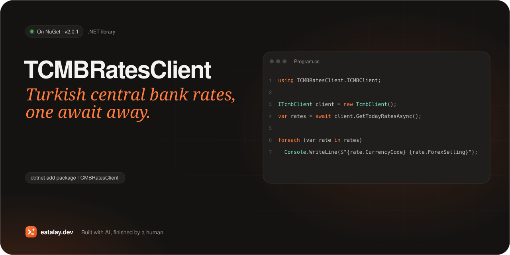

<a href="https://www.nuget.org/packages/TCMBRatesClient"></a>

# TCMBRatesClient

**TCMBRatesClient** is a .NET library for fetching exchange rates from the Central Bank of Turkey (TCMB). This package simplifies retrieving hourly exchange rate data as XML from the TCMB's official service.

---

## Features
- Fetch exchange rate data for specific dates and times.
- Parse XML responses into strongly-typed models.
- Easy integration with .NET applications.

---

## Installation

Install the package via NuGet Package Manager:

```bash
dotnet add package TCMBRatesClient
```

Or use the Visual Studio NuGet Package Manager UI to search for TCMBRatesClient.

---

## Usage

Basic Example

Fetch today's rates:

```csharp
using TCMBRatesClient.TCMBClient;

ITcmbClient client = new TcmbClient();

var rates = await client.GetTodayRatesAsync();

foreach (var rate in rates)
{
    Console.WriteLine($"{rate.NameTr} - {rate.ForexBuying} - {rate.ForexSelling}");
}
```

Filter by currency:

```csharp
using TCMBRatesClient.Models;

var usd = await client.GetTodayRatesAsync(new CurrencyFilter { CurrencyCode = "USD" }, CancellationToken.None);
```
---
## Models


**Contribution**

Contributions are welcome! If you encounter a bug or have suggestions, please open an issue or submit a pull request on the [GitHub](TCMBRatesClient) repository.

---
## License

This package is licensed under the MIT License. See the LICENSE file for more details.

---

## Contact

For inquiries or support, please contact:
- Email: [emrah.atalay@outlook.com](mailto:emrah.atalay@outlook.com)

---

<sub>Made by **Emrah Atalay** at <a href="https://eatalay.dev/en">eatalay.dev</a>: mobile apps, games and automation, built with AI and finished by a human.</sub>
